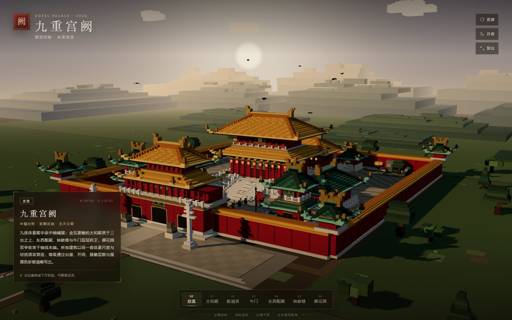
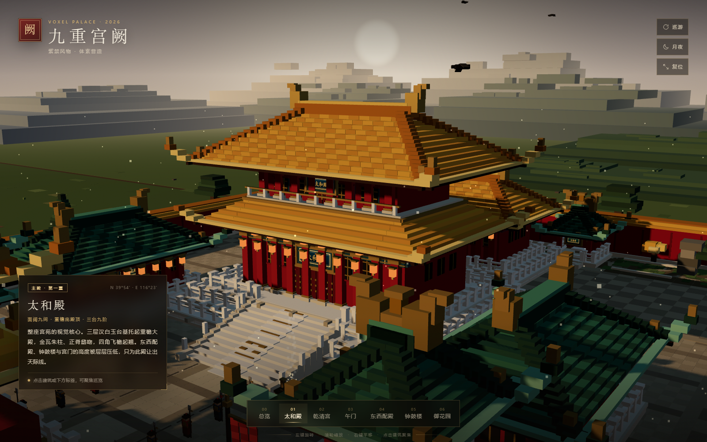
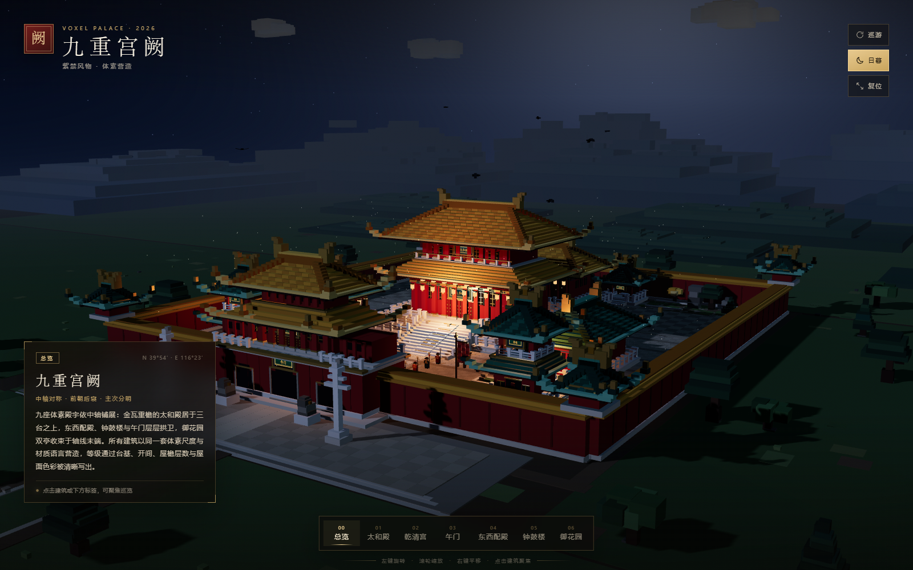
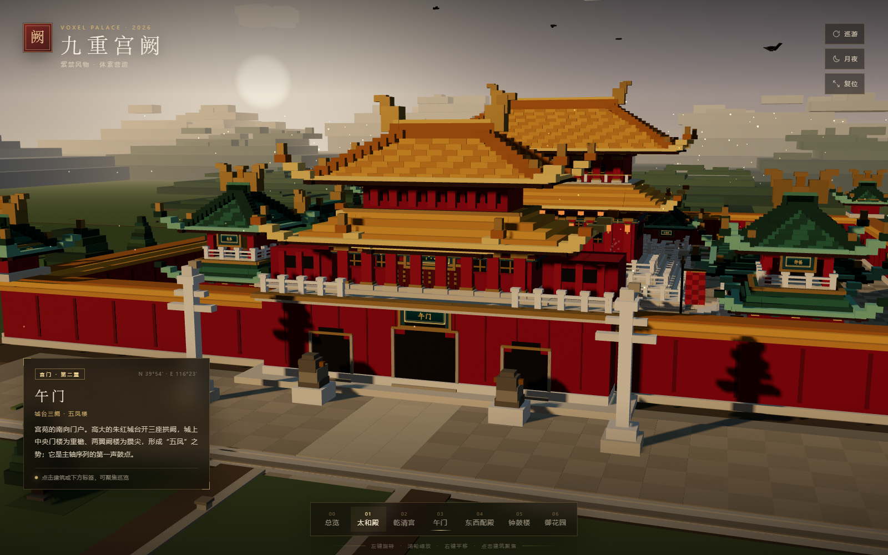
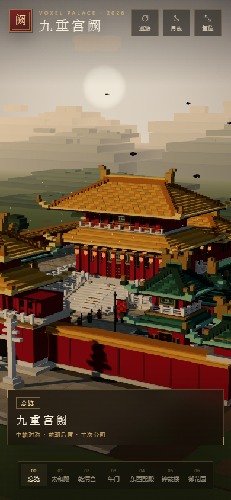

# 九重宫阙 · Voxel Palace

用 **Three.js + 体素方块** 实时营造的一座中国古典宫苑建筑群。中轴对称、前朝后寝，九座殿宇以台基、开间、屋檐层数与屋面色彩写出清晰的等级秩序。

- 纯前端、零构建、无外部网络依赖：Three.js 与全部代码均在本地
- 约 **1.15 万个体素方块**，按材质合并为 3 个静态批次，另有云、鸟、宫旗、香烟、浮尘等动态点缀
- 黄昏 / 月夜两种氛围，可环绕、缩放、平移、自动巡游、点击建筑聚焦



## 场景一览

| | |
| --- | --- |
|  |  |
| 太和殿 · 重檐庑殿 · 三台 | 月夜模式 · 宫灯与星空 |
|  |  |
| 午门 · 城台三阙 · 五凤楼 | 移动端竖屏自适应 |

---

## 运行

### 方式一：直接打开（最简单）

双击 `index.html` 即可。项目使用经典 `<script>` 引入本地 `vendor/three.min.js`，不依赖模块服务器。

### 方式二：本地服务器（推荐）

```bash
node server.mjs
# 或
npm start
```

浏览器打开 <http://127.0.0.1:5173>。

> 需要支持 WebGL2 的现代浏览器（Chrome / Edge / Firefox / Safari 新版均可）。

---

## 操作

| 操作 | 效果 |
| --- | --- |
| 左键拖拽 | 环绕旋转 |
| 滚轮 | 推拉缩放 |
| 右键拖拽 | 平移 |
| 点击建筑 | 聚焦该建筑并显示文牒 |
| 底部标签 / 顶部按钮 | 总览、殿宇聚焦、自动巡游、月夜切换、视角复位 |
| 空格 | 开始 / 暂停自动巡游 |
| `N` | 昼暮 / 月夜切换 |
| `R` | 回到总览 |

---

## 建筑群与等级

| 等级 | 建筑 | 形制 | 在场景中的角色 |
| --- | --- | --- | --- |
| 主殿 · 第一重 | **太和殿** | 重檐庑殿顶 · 三台九阶 | 体量最大、台基最高、唯一重檐；宫苑视觉核心 |
| 宫门 · 第二重 | **午门** | 城台三阙 · 五凤楼式门楼 | 主轴序曲，低城台 + 双阙楼，以横向展开压住前景 |
| 后寝 · 第二重 | **乾清宫** | 单檐庑殿顶 · 二重台基 | 轴线尽端的第二高潮，体量约为太和殿六成 |
| 从属 · 第三重 | **东配殿 / 西配殿** | 单檐庑殿顶 · 绿琉璃瓦 | 左右厢殿，檐口高度刻意压至主殿一半以下 |
| 从属 · 第三重 | **钟楼 / 鼓楼** | 二层楼阁 · 攒尖绿顶 | 细高楼身形成主轴两侧的节奏，不越主殿屋脊 |
| 收束 · 第四重 | **万春亭 / 千秋亭** | 攒尖顶 · 绿琉璃 | 御花园双亭，体量最小，作为轴线最后的轻盈句点 |
| 轮廓层 | 宫墙与四座角楼 | 红墙金瓦 · 角楼攒尖 | 围合与天际线，不计入九座主体建筑 |

等级通过四种可读的语言同时表达：**台基层数**（三台 / 二台 / 单台）、**屋檐层数**（重檐 / 单檐 / 二层）、**开间与体量**、**屋面色彩**（帝王金 / 配殿与楼阁绿）。

场景内另有两列禁军、青铜鼎香火、宫旗、金水河与三座石桥、汉白玉栏杆、丹陛石、华表、石狮、御道与御花园石景等细节。

---

## 目录结构

```
voxel-palace/
├── index.html              # 页面骨架 + HUD
├── server.mjs              # 零依赖静态服务器
├── package.json
├── vendor/
│   └── three.min.js        # Three.js r160（本地）
├── src/
│   ├── voxel.js            # 体素批处理引擎、色板、场景布局
│   ├── palace.js           # 九座建筑 + 宫墙/庭院/金水河 + 视角数据
│   ├── props.js            # 地形、远山、林木、仪仗、云鸟、粒子
│   ├── main.js             # 渲染器、天空、光照、相机、交互、昼夜
│   └── style.css           # 中文古典风格 HUD / 响应式
├── tools/
│   └── shot.mjs            # 无头 Chrome 截图 / 冒烟测试（开发用）
└── shots/                  # 场景截图
```

---

## 技术要点

- **体素合并**：`VoxelBatch` 把每个方块的 6 个面写入按材质分组的顶点/索引缓冲，最终只产生 3 个静态 Mesh（哑光 / 金属 / 自发光），以顶点色区分数百种颜色；保留体素块面感的同时把绘制调用压到极低。
- **无插件相机**：自写带阻尼的 Orbit 相机，支持旋转、缩放、平移、触屏双指、聚焦飞行动画。
- **天空与光照**：自定义渐变天空穹顶（含日盘与地平线暖晖）、ACES Filmic 色调映射、PCFSoft 阴影、半球光 + 暖色主光 + 冷色补光；月夜模式对天空、雾、光强、灯笼点光源、云色、星空做平滑过渡。
- **建筑生成**：庑殿顶/重檐/攒尖顶由参数化“阶梯坡面 + 瓦垄条带 + 垂脊 + 翼角起翘 + 正脊鸱吻”算法拼装；台基、栏杆、踏道、斗拱、彩画额枋、门窗、匾额均为程序化体素。
- **中文匾额**：用 Canvas 绘制低分辨率楷体字，再贴到建筑正面的体素匾框上。
- **环境**：整块平地避免接缝；远山为多层阶梯山体；树有油松 / 侧柏 / 阔叶三种冠形，全部用轴对齐方块构成。
- **动态氛围**：体素云漂移、飞鸟盘旋与振翅、宫旗逐片摆动、青铜鼎香烟与火星、金色尘埃循环。

---

## 截图工具（开发用）

```bash
# 需要本机安装 Chrome；自动启动本地服务器并截图
node tools/shot.mjs --tag=final- --w=1600 --h=1000 \
  --views=overview,main,gate,rear,halls,towers,garden

# 月夜
node tools/shot.mjs --tag=night- --views=overview --night
```

输出位于 `shots/`。该工具仅用于开发验收，不影响场景运行。

---

*本项目为体素风格的艺术再创作，取意于中国古典宫苑的空间秩序，并非古建测绘复原。*
